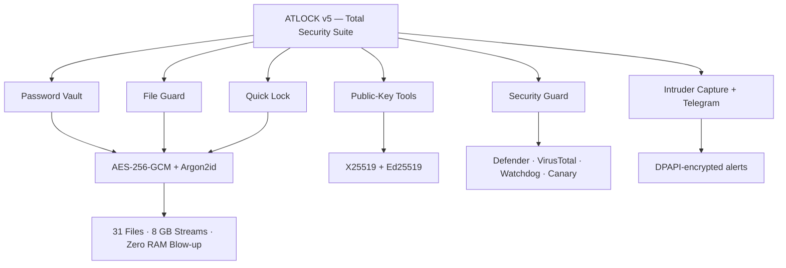

<div align="center">

<a href="https://github.com/Akhouri-Anmol-Kumar/ATLOCK">
  
</a>

**Local-first. No cloud. No account. No subscription. No telemetry.**
*It just cooks, locally.*

<p>
  
  
  
  
</p>

<p>
  
  
  
  
</p>

<br>

<a href="https://github.com/Akhouri-Anmol-Kumar/ATLOCK/releases/download/v5.0.0/ATLOCK_v5.zip">
  
</a>

<sub>Direct download · no sign-up · no ads · <a href="https://github.com/Akhouri-Anmol-Kumar/ATLOCK/releases/latest">browse all releases ↗</a></sub>

<br><br>

<p>
  <a href="#-features">Features</a> ·
  <a href="#-installation">Installation</a> ·
  <a href="#-why-upgrade-from-v4--v5">Why v5?</a> ·
  <a href="#-faq">FAQ</a> ·
  <a href="#️-roadmap">Roadmap</a>
</p>

</div>

---

## 🧭 What is ATLOCK?

> *"We build what others forgot to fix."* — Akhouri Systems

ATLOCK is a **Total Security Suite for Windows** — a password vault, a real file-encryption tool, a right-click lock for Explorer, a Defender cockpit, an intruder-capture system, and a public-key sharing toolkit, all living inside **one portable `.exe`**. No installer, no account, no "upgrade to premium," no phoning home.

- 📦 Single self-contained `.exe` — nothing to install, nothing left behind
- 🚫 No cloud, no account, no subscription, no telemetry — ever
- ▶️ Download → Run → Done
- 🔍 Open about what it can and can't do — see [Honest Security Notes](#️-honest-security-notes-no-cap-edition)

<br>

## 📋 Table of Contents

- [Windows Defender / SmartScreen Warning](#️-windows-defender--smartscreen-warning--this-is-a-false-positive)
- [Features](#-features)
- [Honest Security Notes](#️-honest-security-notes-no-cap-edition)
- [Under the Hood](#️-under-the-hood)
- [50+ Command-Line Tools](#-50-command-line-tools)
- [Installation](#-installation)
- [Why Upgrade from v4 → v5](#-why-upgrade-from-v4--v5)
- [FAQ](#-faq)
- [Verify Your Download](#-verify-your-download)
- [Roadmap](#️-roadmap)
- [Disclaimer](#️-disclaimer)
- [Contributing](#-contributing)
- [License](#-license)
- [About](#️-about)

<br>

## ⚠️ Windows Defender / SmartScreen Warning — This Is a False Positive

Windows may flag `ATLOCK_v5.exe` as an *"unrecognized app"* or *suspicious*. This is a well-known false positive for **unsigned** Windows apps built by solo/indie developers — **it is not malware.**

<details>
<summary><b>🛠️ How to run it anyway</b></summary>
<br>

1. Click **"More info"** on the SmartScreen warning
2. Click **"Run anyway"**
3. ATLOCK opens normally ✅

> Code signing is on the [roadmap](#️-roadmap) to remove this warning entirely. Until then, you can always [verify the download](#-verify-your-download) yourself against the published hash.

</details>

<br>

## ✨ Features

<table>
<tr>
<td width="50%" valign="top">

### 🔑 Password Vault
A real local password manager.
- **AES-256-GCM** encryption, **Argon2id** key derivation
- Add entries with category, user, password, notes, and a 2FA secret
- Built-in password health check: weak / reused / old / breached (k-anonymity — only a hash prefix ever leaves your PC)
- One-click import from Bitwarden, Chrome/Edge, Firefox, KeePass, 1Password

</td>
<td width="50%" valign="top">

### 🗂 File Guard
Real encryption, not a permission flag.
- Lock up to **31 files** with a password or PIN
- Streamed **AES-256-GCM**, chunked — no RAM blow-up even on huge files
- Original plaintext is shredded after sealing
- Optional **Extra Lock**: a USB keyfile and/or a touch of your FIDO2 hardware key, on top of the password

</td>
</tr>
<tr>
<td width="50%" valign="top">

### 🖱 Quick Lock
Right-click encryption, right from Explorer.
- "Secure / Unlock with ATLOCK" in the context menu
- Fresh random 256-bit key per item, identity = your Vault password
- Folders become one streaming `.atlockvault` archive (safe up to 8 GB)
- One-time recovery key shown at creation — split it into shares if you want

</td>
<td width="50%" valign="top">

### 🛡️ Security Guard
A cockpit, not a reimplemented antivirus.
- Live **Windows Defender** dashboard (RTP, Tamper Protection, BitLocker, Secure Boot, firewall...)
- **VirusTotal** check — only a SHA-256 hash is ever sent, never the file
- **Startup Watchdog**: baselines Registry Run keys, services, scheduled tasks, WMI, AppInit_DLLs, Winlogon, IFEO — flags only what's new and suspicious
- **Ransomware Canary Trap**: 24 decoy files; 2+ touched in 20s = alarm

</td>
</tr>
<tr>
<td width="50%" valign="top">

### 📸 Intruder Capture + ✈️ Telegram Sentinel
Every wrong attempt gets a response.
- Webcam photo on a wrong attempt; a 10-second video on critical events
- Instant alert to **your own** Telegram bot (token + chat ID, DPAPI-encrypted) — not a third-party service
- Attempted passwords are logged only as a length mask, **never** the characters
- Media is encrypted at rest and auto-expires

</td>
<td width="50%" valign="top">

### 🔐 Multi-Factor Authentication
Pick your layer.
- **TOTP** — scan a QR with any authenticator app, 10 printed one-time recovery codes
- **FIDO2** — register up to 5 hardware keys (YubiKey etc.), with a non-blocking 60s prompt
- **Windows Hello** — fingerprint / face / PIN
- **TPM Protection** (opt-in) — ties the sealed state to this PC's hardware

</td>
</tr>
<tr>
<td width="50%" valign="top">

### 🤝 Public-Key Tools
Send encrypted files without ever sharing a password.
- One-time identity: **X25519** for encryption + **Ed25519** for signing
- Share your `ATLPUB1:...` public key freely; a short fingerprint confirms it's really yours
- `.atlpk` encrypted files, `.atlsig` signatures — tampered or wrong-signer files are refused before any plaintext exists

</td>
<td width="50%" valign="top">

### 🔀 Shamir Recovery Shares
No single point of failure.
- Split any recovery key into up to 10 shares
- Any *K-of-N* shares rebuild it; *K-1* shares reveal nothing
- Give one to a parent, lock one in a bank box, keep one on a USB stick

</td>
</tr>
<tr>
<td width="50%" valign="top">

### ⏱️ Timed Lock + 🚨 Panic Lock
Honest about what it is.
- Calls Windows' own `LockWorkStation()` — the real lock screen, same as <kbd>Win</kbd>+<kbd>L</kbd> — and **re-locks it** if someone logs back in before your timer's up
- One-click **PANIC LOCK**: locks the Vault, wipes the ATLOCK clipboard, and engages the re-lock loop instantly
- The code says it straight: the re-lock loop is a *discipline tool*, not a security boundary — ending the ATLOCK process stops the re-locking. Your actual protection is the encryption, covered above.

</td>
<td width="50%" valign="top">

### 🧰 50+ CLI Tools
Everything the GUI does, scriptable.
- `--selftest`, `--vault-audit`, `--shamir-split`, `--pk-encrypt`, `--device-health`, `--gen-passphrase`, and 45+ more
- [See the full toolbox ↓](#-50-command-line-tools)

</td>
</tr>
</table>

<br>

## ⚖️ Honest Security Notes (No Cap Edition)

Real security tools tell you their limits. Here they are — straight from ATLOCK's own manual:

- A same-user attacker with admin rights can read any process's RAM. ATLOCK raises the cost (locked buffers, zeroing, anti-debug checks) — it is not magic.
- "Shredding" files on an SSD can't be fully guaranteed (wear-levelling, snapshots). **BitLocker full-disk encryption is the real fix. Turn it on.**
- Forgotten master password + no recovery key = the data is **gone forever**. That's not a bug — that's encryption doing its job.
- TOTP and hardware keys defend against remote attackers and credential stuffing. They do **not** stop someone holding your already-unlocked PC and your physical key.
- Nothing leaves your machine except what *you* configure: your own Telegram bot, a 5-character hash prefix for the breach check, or a file hash for VirusTotal. Never the file, never the password.

<br>

## 🏗️ Under the Hood



| Layer | What it uses |
|---|---|
| Vault & File encryption | AES-256-GCM (authenticated, tamper-evident) |
| Key derivation | Argon2id, benchmarked per-device |
| Public-key tools | X25519 (encrypt) + Ed25519 (sign) |
| Secret storage | Windows DPAPI for bot tokens / chat IDs |
| Hardware-backed option | TPM-sealed state (opt-in) |

<br>

## 🧰 50+ Command-Line Tools

Everything in the GUI has a scriptable twin. A small taste:

<details>
<summary><b>Click to see example commands</b></summary>
<br>

```bash
ATLOCK_v5.exe --selftest                  # crypto & logic self-tests
ATLOCK_v5.exe --vault-audit               # weak / reused / old / breached report
ATLOCK_v5.exe --device-health             # BitLocker / hibernation / cloud-folder check
ATLOCK_v5.exe --gen-passphrase 6          # generate a strong 6-word passphrase
ATLOCK_v5.exe --shamir-split              # split a recovery key into N shares
ATLOCK_v5.exe --pk-encrypt FILE --to PUBKEY --sign
ATLOCK_v5.exe --verify PATH               # check a sealed container without opening it
ATLOCK_v5.exe --help                      # the other 40+
```

The full reference — every flag, grouped by category — is in `ATLOCK_v5_Manual.html` / `ATLOCK_v5_Manual.txt`, bundled with every release.

</details>

<br>

## 📦 Installation

1. [Download the latest release](https://github.com/Akhouri-Anmol-Kumar/ATLOCK/releases/download/v5.0.0/ATLOCK_v5.zip)
2. Extract it to a **local** folder, e.g. `C:\ATLOCK`

> **Not** inside OneDrive / Dropbox / Google Drive — cloud sync will corrupt your encrypted state.
> **Not** in `C:\Program Files` — read-only issues.

3. Double-click `ATLOCK_v5.exe`
4. Done. ATLOCK creates a hidden `.atlock_data` folder next to the exe — that folder **is** your vault, settings, and keys. Back it up.

| Requirement | Details |
|---|---|
| OS | Windows 10 / 11 (64-bit) |
| RAM | 4 GB (8 GB recommended) |
| Disk | ~200 MB free |
| Runtime | None — fully self-contained |
| Camera | Optional — enables Intruder Capture photo/video |

<br>

## 🆕 Why Upgrade from v4 → v5

v5 is a ground-up rebuild, not a patch. Here's the honest diff:

| | v4 | v5 |
|---|---|---|
| Vault encryption | Fernet + PBKDF2-HMAC-SHA256 | **AES-256-GCM + Argon2id** |
| File protection | NTFS ACL permission flags | **Real AES-256-GCM encryption in place** |
| Guarded file limit | 10 files | **31 files**, streamed up to 8 GB |
| 2FA | None | **TOTP · FIDO2 · Windows Hello** |
| Hardware-backed keys | None | **TPM Protection** (opt-in) |
| Sharing files securely | Not available | **Public-Key Tools** (X25519 + Ed25519) |
| Recovery | None — lose it, lose everything | **Vault Recovery Key** + Shamir M-of-N shares |
| Security dashboard | Not available | **Defender · VirusTotal · Watchdog · Canary Trap** |
| Breach alerts | External Gmail/Telegram integration | **Your own Telegram bot**, opt-in, DPAPI-encrypted |
| Scripting | Not available | **50+ CLI tools** |
| "Lock" screen claims | Alt+Tab / Win key blocked, Task Manager killed | Honest: real `LockWorkStation()` + re-lock loop, openly documented as a discipline tool, not a bypass-proof cage |

<br>

## ❓ FAQ

<details>
<summary><b>Is ATLOCK safe to run?</b></summary>
<br>
Yes. It's a locally-run, offline security tool with zero external integrations beyond what you explicitly configure (your own Telegram bot, an optional VirusTotal hash check). The SmartScreen warning is a standard false positive for unsigned indie-developer apps, not a sign of malicious behavior.
</details>

<details>
<summary><b>Does ATLOCK send my data anywhere?</b></summary>
<br>
No, by default. Nothing leaves your PC unless you turn on Telegram alerts (your own bot) or VirusTotal checks (a file hash only, never the file itself).
</details>

<details>
<summary><b>What happens if I forget my master password?</b></summary>
<br>
If you created a <b>Vault Recovery Key</b> (shown once, at setup), it resets your master password. If you didn't — or you've also lost that key — the vault is mathematically unrecoverable. That's the whole point of real encryption: write the recovery key down and store it off this PC.
</details>

<details>
<summary><b>I lost my Extra Lock keyfile / hardware key for a File Guard file.</b></summary>
<br>
That file is unrecoverable — not even the Vault Recovery Key saves it. This is why Extra Lock recommends a backup keyfile on a second USB stick.
</details>

<details>
<summary><b>Can two copies of ATLOCK run at once?</b></summary>
<br>
No — a named mutex keeps it single-instance by design.
</details>

</details>

<br>

## 🔏 Verify Your Download

For any sensitive security tool, don't just trust a download — verify it:

```powershell
certutil -hashfile ATLOCK_v5.zip SHA256
```

Compare the result against the SHA-256 hash published in the **[release notes](https://github.com/Akhouri-Anmol-Kumar/ATLOCK/releases/tag/v5.0.0)** for this version. Each release publishes its own hash — always check the hash listed on that specific release, not an old one.

<br>

## 🗺️ Roadmap

- [ ] Code signing to eliminate the SmartScreen warning
- [ ] Configurable, scheduled Timed-Lock windows
- [ ] Encrypted cloud backup for the vault (opt-in)
- [ ] Cosmetic Lock overlay across multiple monitors
- [ ] Automatic update checker

<br>

## ⚠️ Disclaimer

ATLOCK is intended for personal device security on machines you own or are authorized to manage. Features like webcam-based intruder capture, the Windows session lock loop, and background watchdog monitoring are powerful — use them responsibly and in compliance with local laws and workplace policies. The developer is not responsible for data loss resulting from forgotten passwords, lost recovery keys, or misuse of the File Guard / Extra Lock features. Read the [Honest Security Notes](#️-honest-security-notes-no-cap-edition) before relying on this for anything serious.

<br>

## 🤝 Contributing

Issues and feature requests are welcome via the [Issues tab](https://github.com/Akhouri-Anmol-Kumar/ATLOCK/issues). Pull requests are welcome — please open an issue first to discuss significant changes.

<br>

## 📄 License

Licensed under the **MIT License** — see [LICENSE](LICENSE) for details.

<br>

## 🏛️ About

<div align="center">

**ATLOCK** is a product of **Akhouri Systems** — a desktop software company built on one idea:
*if existing software frustrates you, build something better.*

Developed solely by **Akhouri Anmol Kumar** · Indian Software Developer

<sub>An Akhouri Systems Product</sub>

<br><br>

[🌐 Website](https://akhouri-anmol-kumar.github.io/Akhouri-systems/) · [📖 Releases & Manual](https://github.com/Akhouri-Anmol-Kumar/ATLOCK/releases/latest) · [🐛 Report an Issue](https://github.com/Akhouri-Anmol-Kumar/ATLOCK/issues)

<br>

*Stay locked in. Stay locked out — to everyone else.*

<br><br>

### ⭐ Star History

<a href="https://star-history.com/#Akhouri-Anmol-Kumar/ATLOCK&Date">
  
</a>

</div>
